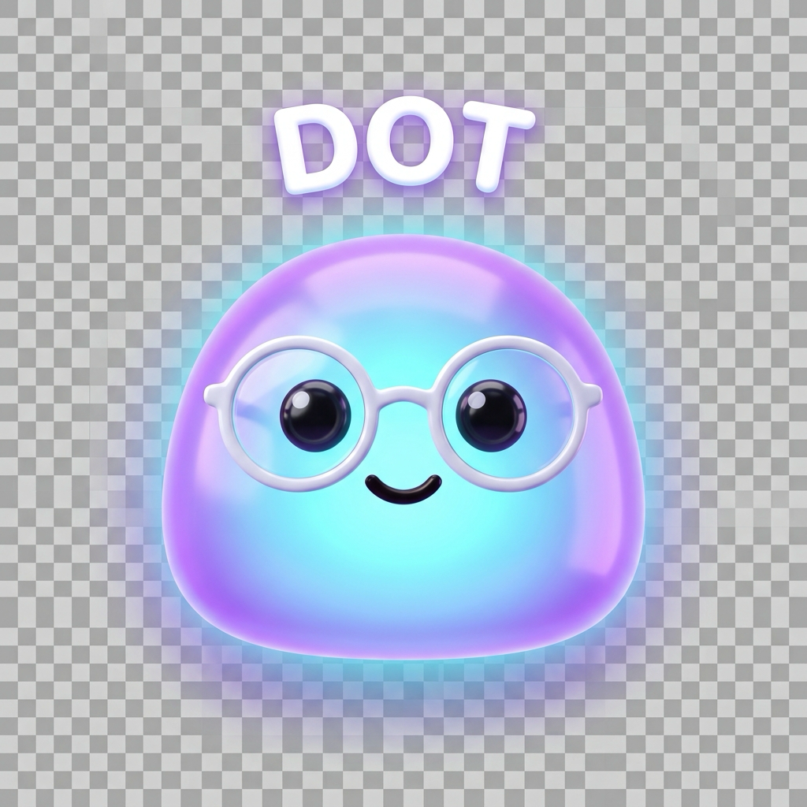

# 🟣 Dot — Personal macOS AI Companion (Powered by Google Gemini)

**Dot** — это нативный персональный аватар-компаньон для macOS, вдохновленный концепцией **Dot от OpenAI / ChatGPT**, но созданный специально под экосистему Mac и работающий на базе **Google Gemini API**.



---

## 🧐 Что такое «Dot» в ChatGPT и OpenAI?

На OpenAI DevDay был представлен **Dot** — концепт **всегда активного персонального агента-компаньона (always-on persistent agent)**:
1. **Визуальный аватар**: Маленький дружелюбный персонаж в виде светящегося пузырька/капельки с выразительными глазами, очками и кастомизируемыми аксессуарами.
2. **Постоянная сущность**: В отличие от временных диалогов, Dot постоянно «живет» на рабочем столе и помнит контекст.
3. **Автономная работа в фоне**: Способен выполнять постоянные поручения (micro-agents / standing goals) — мониторинг, напоминания, периодические проверки.
4. **Интеграция с рабочими инструментами**: Взаимодействие с приложениями, файлами, буфером обмена и голосовым общением.

---

## 🚀 Наш Dot для macOS (на Google Gemini)

Мы перенесли эту концепцию на **чистый, сверхбыстрый нативный стек macOS (Swift + SwiftUI + AppKit)** с нулевыми сторонними зависимостями:

### 🌟 Ключевые возможности:

1. **Живой процедурный аватар (Interactive Procedural Mascot)**:
   - **Следящий взгляд**: Зрачки плавно следят за курсором мыши по всему экрану.
   - **Моргание и физика**: Живая анимация дыхания, сквош и стретч при перетаскивании (Disney squash & stretch), реакция на тыки (poke) с подпрыгиванием и радостным звуком.
   - **Эмоциональные состояния**:
     - 😌 *Idle / Chilling* — спокойное дыхание, моргание.
     - 🧐 *Attentive* — наклоняется вперед при наведении курсора.
     - 💡 *Thinking* — глаза закатываются наверх, вокруг персонажа вращается неоновое орбитальное кольцо частиц.
     - 🗣️ *Speaking* — пульсирующие звуковые волны во время озвучки ответа.
     - 🎉 *Happy* — радостные глазки-дуги (`^ ^`), подпрыгивание и конфетти-звездочки.
     - 😴 *Sleeping* — закрытые глазки (`- -`) и плывущие частицы `z Z Z` при простое.

2. **Кастомизация внешности и аксессуаров**:
   - **Цветовые ауры**: *Aura Purple*, *Neon Cyan*, *Solar Amber*, *Emerald Mint*, *Cloud White*.
   - **Аксессуары**:
     - 👓 *Round Glasses* (круглые стильные очки)
     - 😎 *Cool Shades* (темные солнцезащитные очки с бликом)
     - 🤓 *Nerd Frames* (хипстерские черные оправы)
     - 👑 *Royal Crown* (золотая корона с рубином)
     - 🧢 *Cozy Beanie* (вязаная шапочка с помпоном)
     - 🥳 *Party Hat* (праздничный колпак)
     - 🎧 *Headphones* (геймерские наушники с подсветкой)
   - **Масштаб**: Компактный (64px), Классический (84px), Крупный (108px).

3. **Суперсилы в экосистеме Mac**:
   - 📸 **Screen Vision**: Мгновенный снимок экрана для анализа через мультимодальный Gemini («Посмотри на мой экран и скажи, что не так с этой ошибкой»).
   - 📋 **Интеграция с буфером обмена**: Кнопка чтения и мгновенный анализ скопированного текста или кода.
   - 💻 **Mac Shell Terminal**: Выполнение шелл-команд прямо из чата с отображением статуса и логов (`<<<EXEC: command>>>`).
   - 🔊 **Управление громкостью Mac**: Dot может менять громкость звука (`<<<VOLUME: 50>>>`).
   - 🔔 **Нативные уведомления macOS**: Баннеры в Центре уведомлений (`<<<NOTIFY: Title | Message>>>`).
   - ⚡ **Здоровье Mac & Батарея**: Опрос состояния батареи через `pmset`.
   - 🗣️ **Синтез речи**: Dot разговаривает голосом с настраиваемой скоростью и выбором голоса macOS.

4. **Автономные фоновые цели (Standing Goals)**:
   - Встроенный планировщик задач, работающий в фоне.
   - Например, дозор батареи (предупредит при падении ниже 20%), напоминания об осанке/воде, периодический пинг сервисов.

5. **Опыт macOS**:
   - Прозрачное парящее окно поверх всех рабочих столов (Spaces).
   - Иконка в строке меню (Menu Bar) с быстрым доступом к экрану, настройкам, целям и выходу.
   - Плавное перемещение мышкой в любое удобное место экрана.

---

## 🛠️ Сборка и запуск

### Быстрый запуск готового приложения:
```bash
# В директории проекта:
make run
# или напрямую:
open Dot.app
```

### Пересборка приложения:
```bash
make package
```

---

## 🔑 Настройка Google Gemini API

1. Запустите **Dot.app**.
2. Нажмите на иконку шестеренки (⚙️) в окне Dot или выберите **Preferences...** в строке меню macOS.
3. Вставьте ваш ключ Gemini API (его можно бесплатно получить на [Google AI Studio](https://aistudio.google.com/app/apikey)).
4. Выберите желаемую модель: `gemini-2.5-flash`, `gemini-2.0-flash`, `gemini-1.5-pro` или `gemini-1.5-flash`.
5. Ключ сохраняется в безопасном локальном хранилище вашего Mac.
